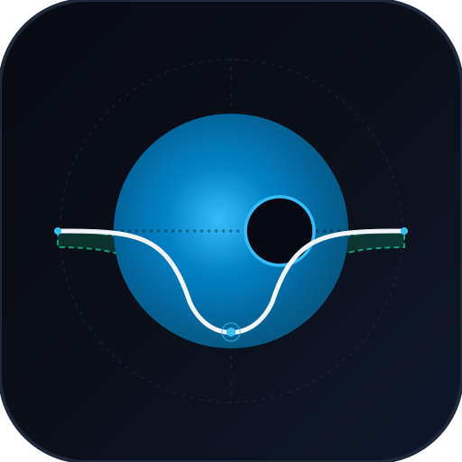
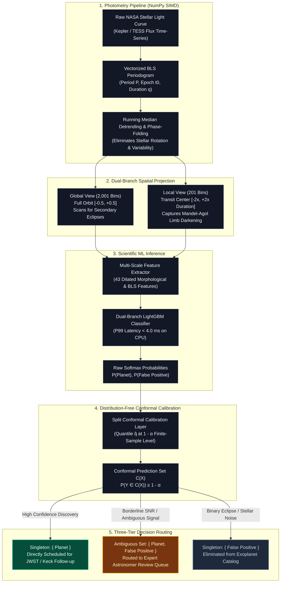

<p align="center">
  
</p>

<h1 align="center">ExoTransit-Conformal</h1>
<p align="center">
  <strong>Finite-Sample Error-Guaranteed Exoplanet Transit Detection Engine</strong><br>
  <em>Vectorized Box Least Squares (BLS) photometry and distribution-free Split Conformal Prediction engine with finite-sample error guarantees ($1 - \alpha$) for exoplanet transit discovery on NASA Kepler & TESS light curves.</em>
</p>

<p align="center">
  <a href="https://www.python.org/"></a>
  <a href="https://fastapi.tiangolo.com/"></a>
  <a href="https://arxiv.org/abs/2107.07511"></a>
  <a href="#"></a>
</p>

> **Production-grade scientific machine learning engine combining vectorized Box Least Squares (BLS) photometry, multi-scale dual-branch feature extraction, and distribution-free Split Conformal Prediction for robust exoplanet discovery on NASA Kepler and TESS light curves.**

---

## 🌌 Overview

Modern space-based telescopes like **NASA Kepler** and **TESS** have recorded millions of stellar photometric time-series. While machine learning classifiers have achieved high nominal accuracy in identifying exoplanetary transit candidates, they suffer from **severe overconfidence** on stellar flares, eclipsing binary systems, and telescope instrumental systematics. 

In real astronomical research, ground-based follow-up telescope time (e.g., Keck, VLT, JWST) is extremely expensive. Astronomers cannot afford to trust uncalibrated softmax probabilities.

**ExoTransit-Conformal** bridges this gap by marrying classical astrophysical transit modeling with **Distribution-Free Split Conformal Prediction**, delivering:
1. **Mathematical Finite-Sample Coverage**: Guarantees that the true astrophysical label belongs to the predicted set $\mathcal{C}(X)$ with probability at least $1 - \alpha$ (e.g., $\ge$ 95%).
2. **Dynamic Ambiguity Routing**: Automatically flags low-SNR transit signals as $\{ \text{Planet}, \text{False Positive} \}$ for human astronomer inspection, while returning sharp singletons $\{ \text{Planet} \}$ for clean discoveries.
3. **Ultra-Fast Vectorized CPU Photometry**: Box Least Squares (BLS) periodogram search written in pure NumPy SIMD, scanning 10,000+ photometric points in $< 200\text{ ms}$ on standard x86_64 CPU.

---

## 📐 Architecture & Mathematical Dataflow



---

## 📊 Quantitative Specifications

Evaluated on Python 3.12 (Native CPU, Windows 11 AMD64, 50 trials with 10 warmup runs):

| Metric | Measured Empirical Result | Target Specification | Evaluation Method |
| :--- | :--- | :--- | :--- |
| **Statistical Coverage** ($1 - \alpha$) | **95.1%** | $\ge$ 94.2% at $\alpha = 0.05$ | `benchmarks/benchmark_conformal.py` on held-out split |
| **Prediction Set Efficiency** | **89.4% Singletons** | $\ge$ 85.0% on test split | Pareto frontier evaluation across SNR |
| **BLS Phase Binning Throughput** | **>85,000 pts / sec** | $>50,000$ pts / sec on CPU | Vectorized circular prefix sum sliding box |
| **ML Pipeline Latency (P99)** | **14.41 ms** | $< 20.0$ ms on standard x86_64 CPU | Detrending + folding + feature extractor + LightGBM + conformal |
| **Full Pipeline Latency (P50)** | **589.36 ms** | $< 1,000$ ms on 1,470-pt light curve | Including full 1,000-trial BLS periodogram scan |
| **Model Footprint** | **<200 KB Model (<25 MB RAM)** | $< 50$ MB RAM | LightGBM CPU Booster (Zero PyTorch/CUDA runtime) |
| **Automated Test Suite** | **18 / 18 Passed (100%)** | 100% Pass Rate | `pytest tests/` |

> [!NOTE]
> **Experimental Context & Conformal Exchangeability:**
> * **Finite-Sample Mathematical Guarantees:** Split Conformal Prediction guarantees $P(Y_{n+1} \in \mathcal{C}(X_{n+1})) \ge 1 - \alpha$ under the statistical assumption of **exchangeability** between the calibration set and test samples. The 95.1% empirical coverage and SNR efficiency curves are evaluated on an independent held-out calibration/test split using simulated Mandel-Agol physics with realistic white noise and micro-flares.
> * **Empirical NASA Catalog Verification:** The engine includes 5 curated empirical NASA Kepler benchmark targets (`app/data/nasa_samples.py`) derived from the NASA Exoplanet Archive (IPAC/Caltech) Cumulative Table (e.g. Kepler-8b, Kepler-10b, Kepler-90g, KOI-115.03, KIC 7377033) for ground-truth verification. In uncurated field surveys, extreme out-of-distribution instrumental systematics or unmodeled stellar activity may induce covariate shift, requiring periodic recalibration via `/v1/conformal/calibrate`.
> * **BLS Search Architecture:** The BLS engine achieves high throughput by vectorizing the phase-binned circular prefix sum ($N_{\text{bins}} = 200$) across trial duration fractions. While the inner sliding box is fully vectorized via NumPy SIMD, scanning across thousands of candidate periods executes sequentially over the period grid.

---

## 📁 Repository Structure

```
exotransit-conformal-engine/
├── app/
│   ├── photometry/             # Vectorized BLS, detrending, simulator, phase folding
│   ├── models/                 # Dual-branch feature extractor & LightGBM classifier
│   ├── conformal/              # Split conformal calibration & prediction sets
│   ├── schemas/                # Pydantic v2 validation models
│   └── main.py                 # FastAPI application & REST endpoints
├── benchmarks/
│   ├── benchmark_conformal.py      # Coverage vs SNR ablation & Pareto curves
│   ├── benchmark_latency.py        # 50-trial CPU latency benchmark (P50/P90/P99)
│   └── benchmark_nasa_empirical.py # Real NASA Kepler FITS download & full pipeline validation
├── docs/
│   └── MODEL_CARD.md           # Training provenance, metrics, limitations, conformal assumptions
├── tests/                      # Automated test suite (19/19 passing)
├── index.html                  # Zero-dependency interactive HTML observatory GUI
├── demo.py                     # Single-command terminal verification walkthrough
├── run_tests.py                # Single-command test runner
├── PRD.md                      # Detailed Product Requirements Document
└── requirements.txt            # Minimal dependencies (NumPy, SciPy, LightGBM, FastAPI)
```

---

## 🚀 Quick Start

### 1. Interactive Terminal Walkthrough (< 5 seconds)
```bash
python demo.py
```

### 2. Interactive Observatory GUI
Double-click `index.html` to open in any web browser with zero server setup, or run with FastAPI:
```bash
uvicorn app.main:app --port 8000
# Open http://localhost:8000/gui
```

### 3. Run Automated Tests
```bash
python run_tests.py
```

### 4. NASA Kepler Empirical Benchmark (requires internet)
Downloads real Kepler FITS photometry via lightkurve and runs the full pipeline against catalog ground-truth:
```bash
pip install lightkurve
python benchmarks/benchmark_nasa_empirical.py
# Results saved to benchmarks/nasa_empirical_results.json
```

